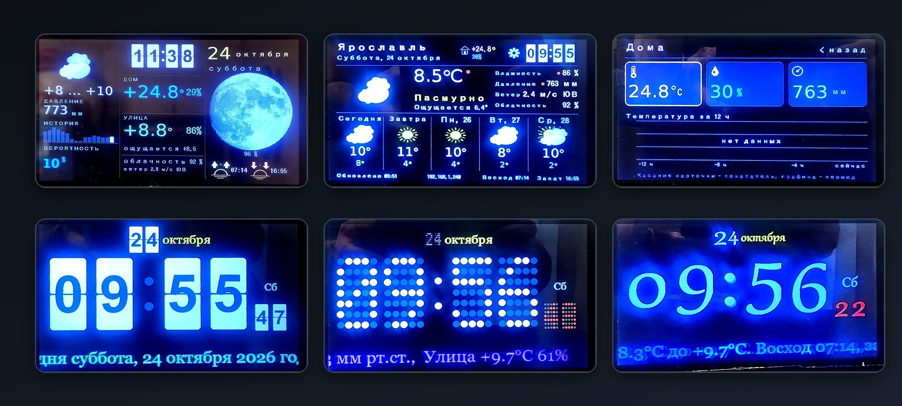

# SKYCAST — ESP32-S3 Weather Station (Sunton 7")

[Русская версия](README.md) · [English](README.en.md)

Firmware for a home weather station with a big 800×480 screen: current weather, 5-day forecast,
Wi-Fi sensors, pressure history, clocks, alarm, Telegram bot and Home Assistant integration.



## Screenshots

| Main screen | Second screen |
|---|---|
|  |  |

| "Home" screen | Big clock |
|---|---|
|  |  |

More clock styles: [classic](docs/screenshots/05-clock-classic.jpg) and [dot matrix](docs/screenshots/06-clock-dots.jpg).

## Features

- **Main screen** — weather temperature, humidity/pressure, condition, 5-day forecast,
  sunrise/sunset, scrolling ticker.
- **Second screen** — clock, "Home" block (Wi-Fi sensors), "Street" block (weather),
  precipitation probability, pressure history chart, moon phase, sunrise/sunset.
- **"Home" screen** — three cards (temperature, humidity, pressure), each source is selected
  separately in the web UI, chart for 3/6/12 hours.
- **Clock screen** — large digits, 7 styles, weather beside.
- **Animated weather icons** — frame set in LittleFS (15 icons × 8 phases).
- **Moon phases** — 16 frames in LittleFS, drawn large on the second screen.
- **Wi-Fi sensors** — HTTP push from external ESP sensors, "main"/"home" selection, staleness threshold.
- **Weather sources** — OpenWeatherMap (default), Pirate Weather (by key).
- **Web UI** — network, keys, brightness, clock settings; integrations, sensors, Telegram pages,
  OTA firmware update.
- **Home Assistant** — MQTT Discovery (sensors, buttons "Reboot", "Next screen", "Home screen",
  "Big clock", brightness number) **and** a HACS integration that polls a local HTTP API.
- **Telegram** — reports, commands, inline buttons.
- **Alarm** — MP3 from SD card via I2S (MAX98357).

## Hardware

- **Board**: Sunton ESP32-8048S070 (ESP32-S3 N16R8: 16 MB flash, 8 MB PSRAM), 7" 800×480 screen, GT911.
- **Display**: RGB panel, LovyanGFX.
- **Audio**: I2S → MAX98357 → P6 connector, optional SD card for MP3.
- **Sensors**: external Wi-Fi sensors (BME280/BMP280 on the station itself was removed).

## Build

The project uses **pioarduino** (Arduino core 3.3.7):

```bash
platformio run -e skycast -t upload      # firmware
platformio run -e skycast -t uploadfs    # file system: icons, moon, logo
```

Environments: `skycast` (main) and `skycasttest` (minimal display test).

Flash layout — `partitions_16MB.csv`: two 6.5 MB application slots and a 3.6 MB LittleFS data partition.

## Files in `data/`

| File | Purpose |
|---|---|
| `icons.bin` | animated weather icons (`ICN1` format), 15 icons × 8 frames |
| `moon.bin` | moon phases (`MOON` format), 16 frames 144×144 |
| `logo.png` | logo (embedded into firmware separately, file is the source) |

## Setup

1. Flash firmware and file system.
2. Connect to the station's access point on first boot (or to the same network).
3. Open the web UI at the address printed in the log: `http://<ip>/`.
4. Set Wi-Fi, OpenWeatherMap key (or Pirate Weather), coordinates, time zone.
5. For Home Assistant — enable MQTT on the "Integrations" page.

Web settings login — `admin`, the password is set on the "Integrations" page
(empty password disables OTA updates).

## SKYCAST Sensor (`skycast-sensor/`)

Separate firmware for ESP8266 (Wemos D1 mini) or ESP32: it auto-detects connected sensors
(BME280/BMP280 over I2C, DS18B20 over OneWire) and posts readings to the station once a minute
over Wi-Fi (`POST /api/sensor`).

Build: `cd skycast-sensor && pio run -e esp8266 -t upload` (or `-e esp32`).

**Before building** create `skycast-sensor/src/secrets.h` with your values
(this file is in `.gitignore` and never committed):

```cpp
#define WIFI_SSID    "your-wifi"
#define WIFI_PASS    "your-password"
#define STATION_HOST "192.168.1.100"
#define STATION_PORT 80
#define STATION_KEY  ""
```

Without this file the firmware builds with placeholders and will not connect.

## Home Assistant: two ways

### 1. MQTT Discovery (nothing to install)

Enable MQTT on the station's "Integrations" page — entities appear automatically.
Topics: `skycast/<mac>/...`, discovery — `homeassistant/...`.

### 2. HACS integration (local HTTP API)

Component `custom_components/skycast` polls the station directly over HTTP
(`GET /api/state`), MQTT is not required.

**Install via HACS:**

1. HACS → "Integrations" → ⋮ → **Custom repositories**
2. URL: `https://github.com/skycast-project/skycast`, category — **Integration**
3. Install "SKYCAST Weather Station" → restart Home Assistant
4. Settings → Devices & services → **Add integration** → "SKYCAST Weather Station"
5. Enter the station IP (shown at the bottom of its screen)

**Without HACS:** copy `custom_components/skycast` into `/config/custom_components/` and restart HA.

**Control from Home Assistant:** buttons "Next screen", "Home screen", "Big clock", "Reboot"
and a brightness slider (5–100 %). Commands go to `GET /api/cmd?c=<command>&v=<value>`.

**Entities:** a SKYCAST device with temperature, feels-like, humidity, pressure, wind, direction,
cloud cover, precipitation probability, condition, "Home" readings, plus per-sensor temperature
and humidity for every Wi-Fi sensor, and 5-day forecast min/max/precipitation.

**Station API:** `GET http://<ip>/api/state` — JSON with `weather` (current weather, 5-day forecast,
precipitation probability) and `sensors` (main, home and all Wi-Fi sensors).

## Project layout

```
custom_components/skycast/  Home Assistant integration (HACS)
src/            station sources (screens, weather, sensors, integrations)
skycast-sensor/ wireless sensor firmware (ESP8266/ESP32)
data/           LittleFS assets
hwtest/         separate display test
partitions_16MB.csv
platformio.ini
```

## License

MIT — see [LICENSE](LICENSE). Free to use, modify and distribute with attribution.
Built on open-source libraries (LovyanGFX, ArduinoJson, ESPAsyncWebServer, PubSubClient,
ESP32-audioI2S) — each with its own license.
