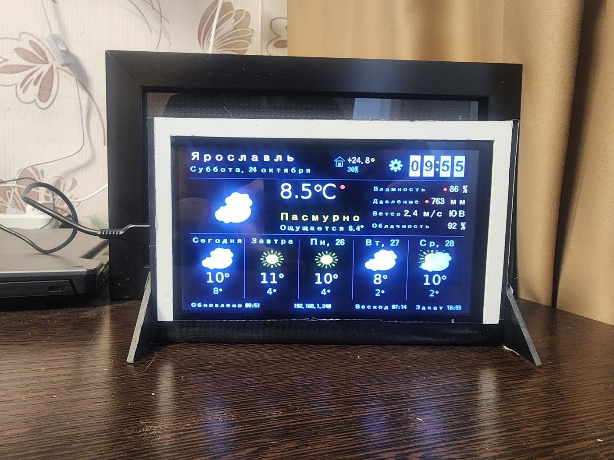
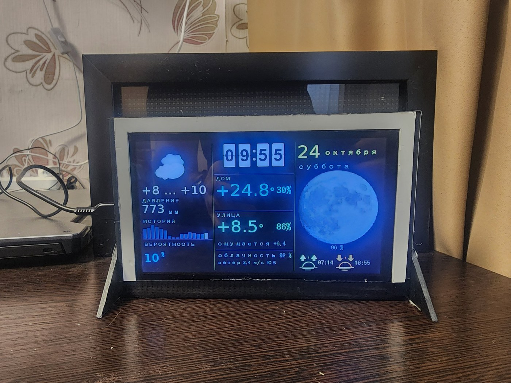
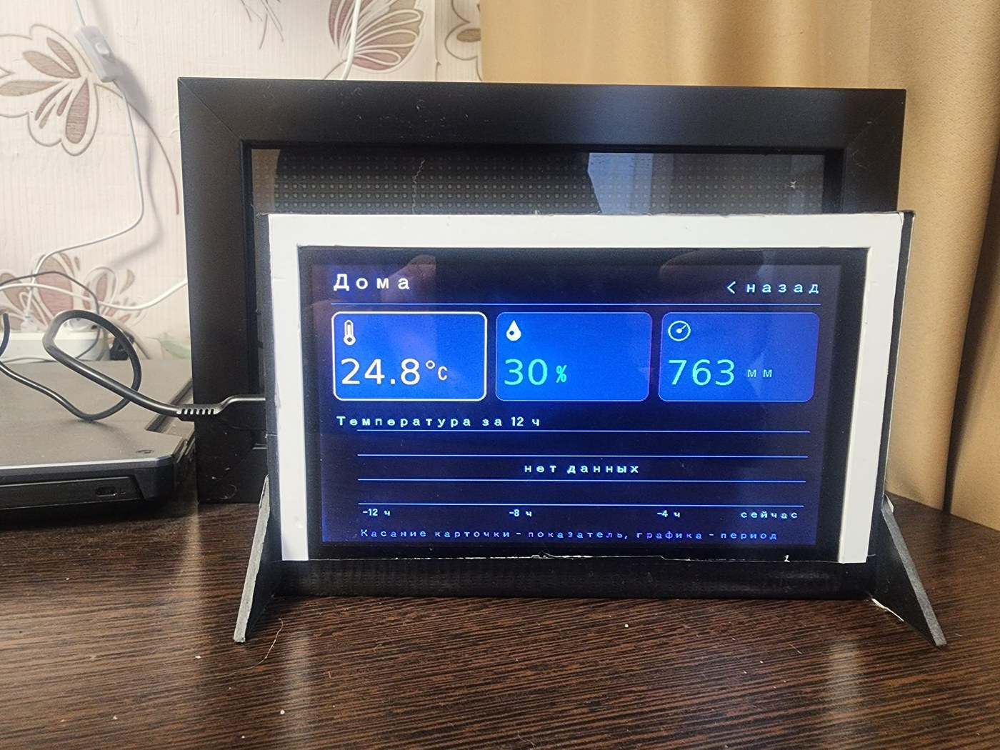
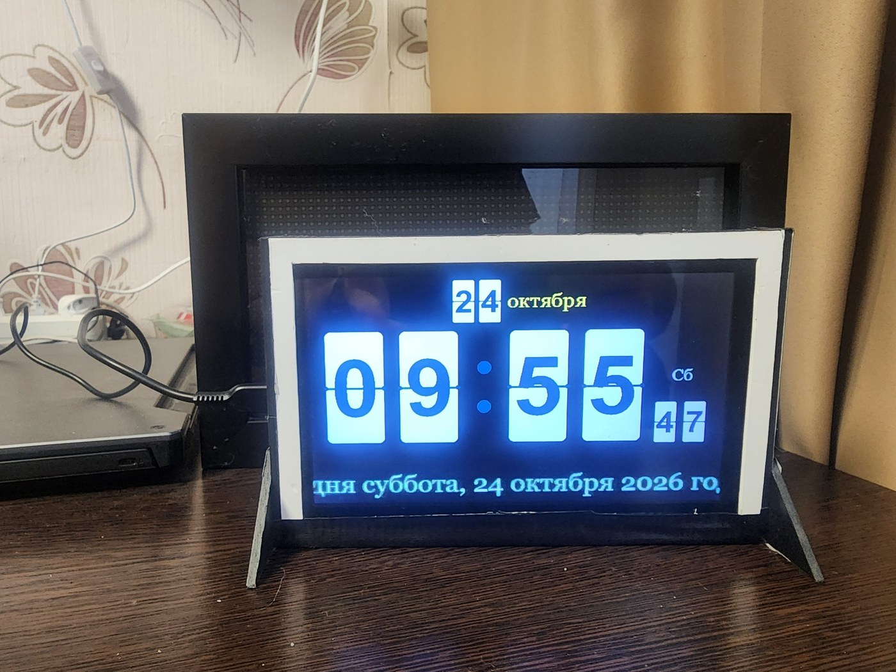

# SKYCAST — метеостанция на ESP32-S3 (Sunton 7")

Прошивка домашней метеостанции с большим экраном 800×480: текущая погода, прогноз,
датчики по Wi-Fi, история давления, часы, будильник, Telegram-бот и интеграция с Home Assistant.

## Скриншоты

| Главный экран | Второй экран |
|---|---|
|  |  |

| Экран «Дома» | Большие часы |
|---|---|
|  |  |

Ещё стили часов: [классические](docs/screenshots/05-clock-classic.jpg) и [точечные](docs/screenshots/06-clock-dots.jpg).

## Что умеет

- **Главный экран**: температура с погодного сервиса, влажность/давление, описание,
  прогноз на 5 дней, восход/закат, бегущая строка.
- **Второй экран**: часы, блок «Дом» (показания Wi-Fi датчиков), «Улица» (погода),
  вероятность осадков, история давления с графиком, фаза луны, восход/закат.
- **Экран «Дома»**: три карточки (температура, влажность, давление), источник
  для каждой выбирается отдельно в веб-интерфейсе, график за 3/6/12 часов.
- **Экран часов**: крупные цифры, 7 стилей, погода рядом.
- **Анимированные иконки погоды**: набор кадров в LittleFS (15 иконок × 8 фаз).
- **Фазы луны**: 16 кадров в LittleFS, рисуется крупно на втором экране.
- **Датчики по Wi-Fi**: приём показаний по HTTP от внешних ESP-датчиков,
  выбор «основного» и «домашнего», порог устаревания.
- **Погодные источники**: OpenWeatherMap (по умолчанию), Pirate Weather (по ключу).
- **Веб-интерфейс**: настройки сети, ключей, яркости, часов; страницы интеграций,
  датчиков, Telegram, OTA-обновление прошивки.
- **Home Assistant**: MQTT Discovery — датчики, кнопки «Перезагрузка», «Сменить экран»,
  «Экран Дома», «Большие часы», число яркости.
- **Telegram**: отчёты, команды, инлайн-кнопки.
- **Будильник**: MP3 с SD-карты через I2S (MAX98357).

## Железо

- **Плата**: Sunton ESP32-8048S070 (ESP32-S3 N16R8: 16 МБ flash, 8 МБ PSRAM), экран 7" 800×480, GT911.
- **Дисплей**: RGB-панель, LovyanGFX.
- **Звук**: I2S → MAX98357 → разъём P6, опционально SD-карта для MP3.
- **Датчики**: внешние Wi-Fi датчики; собственный BME280/BMP280 из проекта удалён.

## Сборка

Проект использует **pioarduino** (Arduino core 3.3.7):

```bash
platformio run -e skycast -t upload      # прошивка
platformio run -e skycast -t uploadfs    # файловая система: иконки, луна, логотип
```

Окружения: `skycast` (основное) и `skycasttest` (минимальный тест экрана).

Разметка флеша — `partitions_16MB.csv`: два слота приложения по 6.5 МБ и раздел
данных LittleFS 3.6 МБ.

## Файлы в `data/`

| Файл | Назначение |
|---|---|
| `icons.bin` | анимированные иконки погоды (формат `ICN1`), 15 иконок × 8 кадров |
| `moon.bin` | фазы луны (формат `MOON`), 16 кадров 144×144 |
| `logo.png` | логотип (в прошивку вшит отдельно, файл — исходник) |

## Настройка

1. Прошить прошивку и файловую систему.
2. Подключиться к точке доступа станции при первом запуске (или к той же сети).
3. Открыть веб-интерфейс по адресу из лога: `http://<ip>/`.
4. Задать Wi-Fi, ключ OpenWeatherMap (или Pirate Weather), координаты, часовой пояс.
5. Для Home Assistant — включить MQTT на странице «Интеграции».

Логин веб-настроек — `admin`, пароль задаётся на странице «Интеграции»
(пустой пароль отключает OTA-обновление).

## SKYCAST Sensor (`skycast-sensor/`)

Отдельная прошивка для ESP8266 (Wemos D1 mini) или ESP32: сама находит подключённые
датчики (BME280/BMP280 на I2C, DS18B20 на OneWire) и раз в минуту отправляет
показания на станцию по Wi-Fi (`POST /api/sensor`).

Сборка: `cd skycast-sensor && pio run -e esp8266 -t upload` (или `-e esp32`).

**Перед сборкой** создайте `skycast-sensor/src/secrets.h` со своими значениями
(этот файл в `.gitignore` и в репозиторий не попадает):

```cpp
#define WIFI_SSID    "your-wifi"
#define WIFI_PASS    "your-password"
#define STATION_HOST "192.168.1.100"
#define STATION_PORT 80
#define STATION_KEY  ""
```

Без этого файла прошивка соберётся с заглушками и не подключится к сети.

## Структура

```
src/            исходники станции (экраны, погода, датчики, интеграции)
skycast-sensor/ прошивка беспроводного датчика (ESP8266/ESP32)
data/           файлы LittleFS
hwtest/         отдельный тест экрана
partitions_16MB.csv
platformio.ini
```

## Лицензия

MIT — см. [LICENSE](LICENSE). Можно свободно использовать, изменять и распространять
с указанием авторства. Проект собирается из открытых библиотек (LovyanGFX, ArduinoJson,
ESPAsyncWebServer, PubSubClient, ESP32-audioI2S) — у каждой своя лицензия.

